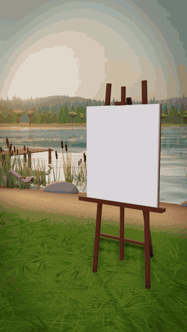
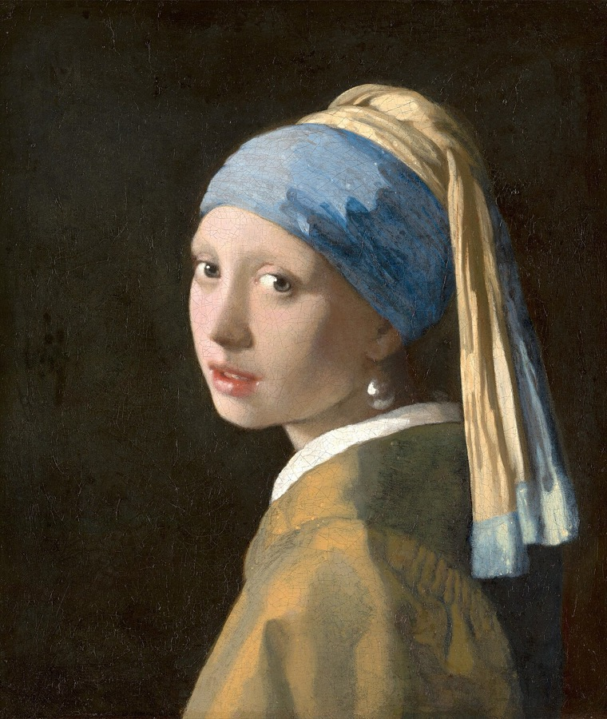
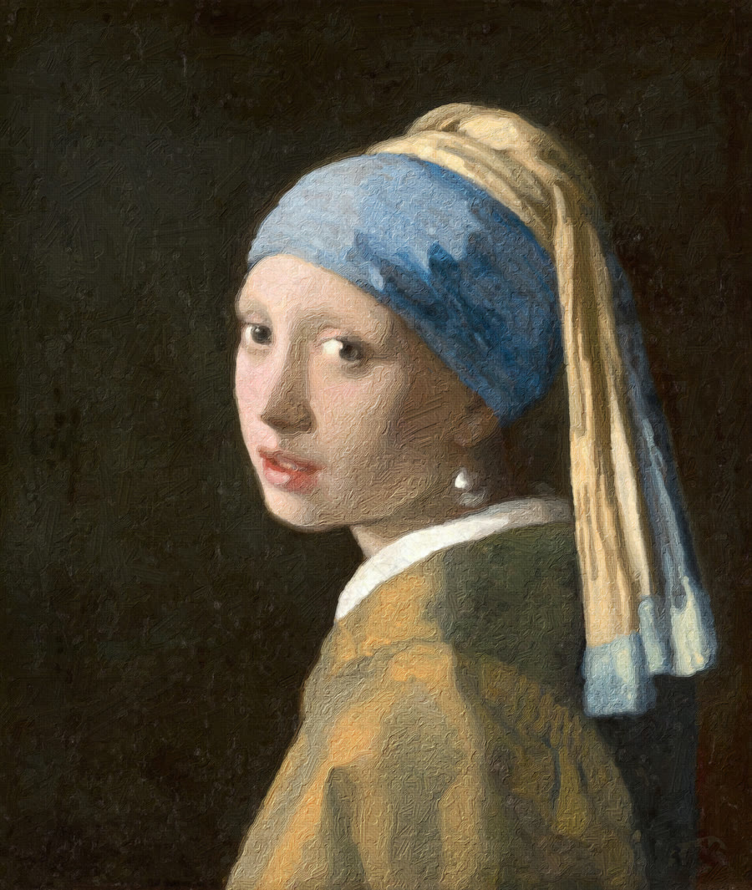

# Ressam

Bir fotoğraf seç; 3B bir sahnede, şövaledeki tuvale fırçayla sıfırdan boyansın. Fırça darbeleri fotoğraftan kodla hesaplanıyor. Yapay zekâ yok, sunucu yok, her şey tarayıcıda çalışıyor.

<p align="center">
  
</p>

[Demo videosu (MP4, 17 sn)](docs/demo.mp4)

| Fotoğraf | Ressamın tablosu |
|---|---|
|  |  |

Örnek görsel: Johannes Vermeer, *İnci Küpeli Kız* (1665). Kamu malıdır ve [Wikimedia Commons](https://commons.wikimedia.org/wiki/File:1665_Girl_with_a_Pearl_Earring.jpg)'tan alınmıştır.

## Nasıl çalışıyor

1. **Fırça darbeleri (Rust → WebAssembly):** Fotoğraf iriden inceye beş katmanda boyanıyor. Her katmanda resim fırça boyuna göre bulanıklaştırılıyor. Tuvalde fotoğraftan en çok ayrılan bölgeler bulunuyor. Her bölgeden fotoğrafın kenarlarını izleyen bir fırça darbesi çiziliyor. Kod: [`wasm/src/lib.rs`](wasm/src/lib.rs).
2. **Sahne (three.js):** Şövale, ortam (göl, saat) ve fırçayı tutan el. El, fırça ucunu ters kinematikle (IK) takip ediyor.
3. **Bitiş:** Kamera tuvale yaklaşıyor. Tabloya boya kabartması ve keten dokusu ekleniyor. Tablo PNG, oynatma MP4/WebM olarak indirilebilir.

## Çalıştırma

Docker ile:

```bash
docker build -t ressam .
docker run -d -p 8080:80 ressam
```

Sonra tarayıcıda http://localhost:8080 adresini aç.

Docker olmadan, herhangi bir statik sunucuyla:

```bash
python3 -m http.server 8080
```

Rust kodunu değiştirirsen `js/ressam.wasm` dosyasını yeniden derle (`rustup target add wasm32-unknown-unknown` gerekir):

```bash
./build.sh
```

Testler ve hız ölçümü:

```bash
cd wasm && cargo test --release && cargo run --release --example bench
```

## Dosyalar

| Dosya | Görevi |
|---|---|
| `wasm/src/lib.rs` | Fırça darbesi katmanları ve tuval dokusu (Rust) |
| `js/wasm.js` | WebAssembly modülünü yükleyip sarmalar |
| `js/strokes.js` | Darbeleri çizer, tabloyu birleştirir |
| `js/stage.js` | Şövale, tuval ve kamera |
| `js/painter.js`, `js/hand.js` | Fırçayı tutan el ve kol IK'sı |
| `js/environments.js` | Mekân ve saat ortamları |
| `js/app.js` | Arayüz, oynatma ve kayıt |

El modeli, three.js örneklerindeki `Michelle.glb` (Mixamo). three.js ile birlikte jsDelivr CDN'inden yükleniyor.
